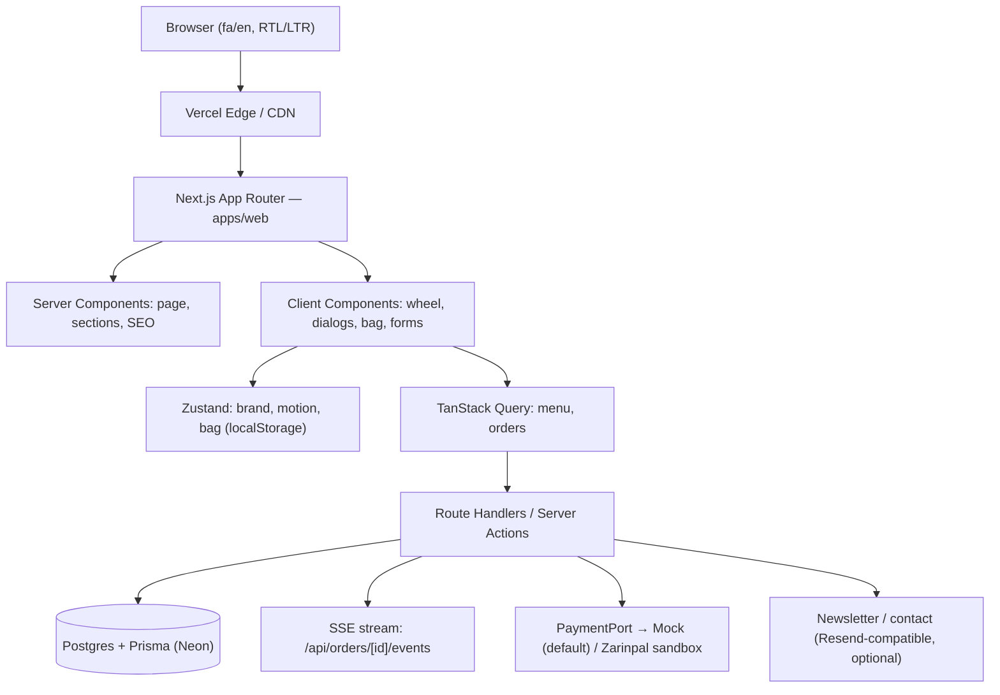

# Architecture & Plan — ela-coffee (Phase 1)

- **Status:** Phase 1 — approved by the user on 2026-11-24 (Phase 0 audit confirmed).
- **Source of truth for fidelity:** `docs/reference-audit.md` and `docs/reference-baseline/`.
- **Language rule:** code, comments, commit messages and this document are in English. Explanations to the user are in Persian (`docs/fa/`).

## 1. What we are building

A bilingual (fa default, en) rebuild of the Kuro single-page coffee template as a
production Next.js app, plus the features the reference does **not** have:
cart → checkout/reservation with live order status, contact channels for Iran,
and a client-handover-ready codebase. The reference is one page with two
brands (coffee `ela` / matcha `midori`) switched client-side; the rebuild
keeps that exact behaviour and adds a real backend behind it.

Non-goals for v1: multi-branch / multi-tenant support, a separate admin panel
(a minimal content-editing path via data files + documented DB edits is enough),
native apps, and Micro Frontends (see §3.4).

## 2. System overview



Deployment: Vercel (preview per PR, production on `main`). Database: hosted
Postgres (Neon free tier is the default recommendation; Supabase is the
documented alternative). No long-lived server process on Vercel — see §8.

## 3. Monorepo

pnpm workspace. Lean on purpose: only split what is genuinely shared.

```
ela-coffee/
  apps/web/                  # the only app in v1
  packages/ui/               # design system: Button, Pill, Dialog, Toast,
                             # Stepper, Price, Reveal, Marquee (React + Tailwind)
  packages/config/           # eslint, typescript, tailwind, prettier presets
  packages/i18n/             # fa/en message dictionaries, formatters
                             # (Jalali dates, fa digits, Toman prices)
  docs/  ASSETS.md  README.md  .env.example
```

### 3.1 Why a monorepo, why this shape

- One app + shared UI/config/i18n is the smallest structure that still
  demonstrates monorepo skills and keeps the design system reusable.
- `packages/ui` is framework-light (React + Tailwind only, no Next.js
  imports) so it can be reused by a future app (e.g. an admin or kiosk app)
  without modification.
- `packages/i18n` holds **no** React code — pure dictionaries + `Intl`
  formatters — so messages can be tested and linted in isolation.

### 3.2 What is NOT split

No `packages/api`, no shared `packages/db` in v1: the data layer lives in
`apps/web/lib/` because only one app consumes it. Splitting it now would add
indirection with no second consumer. If a second app appears, extract it then.

### 3.3 Micro Frontends — when they would make sense (and why not here)

Micro Frontends pay off when independent teams deploy independent parts of a
large surface (e.g. shop, checkout, account owned by three teams with
separate release trains). Here there is one team, one page, one deployable —
Module Federation would add versioning, shared-dependency and routing
complexity for zero benefit, and would hurt the performance budget (duplicate
React runtimes, larger JS). Documented here so the decision is defensible in
an interview and to the client.

## 4. Tech stack (decisions + justification)

| Area         | Choice                                                                                          | Why (and what was rejected)                                                                                                                                                                                                                                                                                                                                                                                                                   |
| ------------ | ----------------------------------------------------------------------------------------------- | --------------------------------------------------------------------------------------------------------------------------------------------------------------------------------------------------------------------------------------------------------------------------------------------------------------------------------------------------------------------------------------------------------------------------------------------- |
| Framework    | Next.js (latest stable), App Router, strict TypeScript, no `any`                                | Required by the brief; RSC gives SEO + fast static sections, Route Handlers give the API without a second server. Pages Router rejected: no RSC, worse i18n story.                                                                                                                                                                                                                                                                            |
| Styling      | Tailwind CSS v4, tokens as CSS variables, logical properties (`ms-/me-/ps-/pe-`)                | Tokens come verbatim from the audit (§3). Logical properties are the only correct way to mirror layout in RTL without a second stylesheet.                                                                                                                                                                                                                                                                                                    |
| i18n         | `next-intl`, routes `/fa` and `/en`, default `fa`, correct `dir`/`lang`                         | `next-intl` is the standard App Router solution (type-safe messages, middleware locale routing). Hand-rolled context rejected: no type safety, easy to break `hreflang`.                                                                                                                                                                                                                                                                      |
| Client state | Zustand (brand, motion-paused, bag)                                                             | Tiny, typed, no provider boilerplate; bag persists to localStorage. Redux rejected: too much ceremony for three small stores.                                                                                                                                                                                                                                                                                                                 |
| Server state | **TanStack Query** (chosen over SWR)                                                            | Menu/order data needs background refetch, stale-while-revalidate, optimistic updates for the bag/checkout, and DevTools for debugging. SWR is simpler and would suffice for read-only menus, but TanStack Query's mutation + cache-invalidation model is the better fit once checkout and live order status exist, and it is the more interview-defensible choice for a data-heavy app. SWR remains a valid alternative for a read-only site. |
| Forms        | React Hook Form + Zod, schemas shared client/server                                             | One Zod schema imported by both the form and the Route Handler — validation cannot drift between client and server.                                                                                                                                                                                                                                                                                                                           |
| Animation    | Hand-rolled CSS + IntersectionObserver (no animation library)                                   | The audit proved the reference uses exactly this (CSS custom properties, `@property`, `data-reveal`/`data-revealed`, no GSAP/Framer/Lenis signatures). Adding a library would increase JS for Iran's slow connections and change the feel. `prefers-reduced-motion` and `data-motion=paused` are preserved.                                                                                                                                   |
| Icons        | `lucide-react` (ISC)                                                                            | The reference uses Lucide inline SVG; the package gives the same icons with the same names, typed.                                                                                                                                                                                                                                                                                                                                            |
| Fonts        | `next/font/local`, self-hosted: Fraunces, Manrope, Geist Mono + **Vazirmatn** for fa            | No Google Fonts / CDN (blocked/slow in Iran). Latin subsets only for the Latin families; Vazirmatn covers Persian. `font-display: swap` + fallback metrics from the audit.                                                                                                                                                                                                                                                                    |
| Database     | Postgres + Prisma                                                                               | Typed data layer, migrations in Git, works on Neon/Supabase free tiers. SQLite rejected for production (Vercel serverless has no persistent disk).                                                                                                                                                                                                                                                                                            |
| Real-time    | **SSE (primary) + polling fallback**                                                            | See §8.                                                                                                                                                                                                                                                                                                                                                                                                                                       |
| Payment      | `PaymentPort` abstraction; Mock provider by default, Zarinpal sandbox behind the same interface | See §9. Never store card data.                                                                                                                                                                                                                                                                                                                                                                                                                |
| Testing      | Vitest + React Testing Library, Playwright (E2E + visual regression), axe-core                  | Unit: utils/validators/formatters. Component: design-system + forms. E2E: core flows in both locales. Visual: Playwright screenshots vs `docs/reference-baseline/`.                                                                                                                                                                                                                                                                           |
| Tooling      | ESLint, Prettier, Husky + lint-staged, Commitlint (Conventional Commits), GitHub Actions CI     | CI runs type-check, lint, unit tests, build, Playwright smoke tests, Lighthouse (on preview), `npm audit`.                                                                                                                                                                                                                                                                                                                                    |

## 5. Rendering split (Server vs Client Components)

| Server Components (default)                                                                          | Client Components (`"use client"`, only where needed)                                                                                                                                                             |
| ---------------------------------------------------------------------------------------------------- | ----------------------------------------------------------------------------------------------------------------------------------------------------------------------------------------------------------------- |
| Page composition, Story, Menu grid, Process, Origins, Join, Footer, metadata/JSON-LD, sitemap/robots | `FlavorWheel` (drag/scroll, `--rot`), `BrandToggle`, `MenuDrawer`, `FlavorDialogs`, `BagDrawer` + toast, `JoinForm` / checkout / reservation forms, `OrderStatus` (SSE consumer), `Reveal` (IntersectionObserver) |

Rule: a component becomes a Client Component only when it needs browser
events, animation state, or local state. Static/SEO content never ships JS
for itself. Brand data (12 drinks, origins, process steps) is a typed
server-side dataset passed down as props; only the _selected_ brand/flavour
index lives in client state.

## 6. Routes and pages

```
/fa            /en            # the single page (default locale fa)
/fa/...        # same anchors: #hero #story #menu #process #origins #join
/api/menu                  # GET menu (both brands), cached, revalidated
/api/newsletter            # POST { email } — Zod, honeypot, rate-limited
/api/reservations          # POST + GET status
/api/orders                # POST create order (Zod, idempotency key)
/api/orders/[id]           # GET order
/api/orders/[id]/events    # GET SSE stream of order-status events
/api/contact               # POST contact form
/robots.txt  /sitemap.xml  # per-locale, generated
```

Custom `not-found.tsx` (branded 404, fa/en) and `error.tsx` / `global-error.tsx`
(500, no stack traces leaked). The reference's 404 copy ("This cup is empty")
is kept, translated professionally for fa.

## 7. Data model (Prisma sketch — finalised in Phase 6)

```prisma
model Drink {
  id        String   @id            // e.g. "ela-original"
  brand     Brand                     // KURO | MIDORI (DB enum label — see note below)
  slug      String   @unique
  nameFa    String
  nameEn    String
  priceToman Int                    // placeholder prices, §11
  caffeineMg Int                    // 150 coffee, 70 matcha
  notesFa   String[]                // tasting notes (ONE source of truth —
  notesEn   String[]                // fixes the reference's matcha bug)
  image     String
  sort      Int
}

model Order {
  id        String   @id @default(cuid())
  status    OrderStatus @default(RECEIVED) // RECEIVED → PREPARING → READY → DONE
  items     OrderItem[]
  customerName String
  phone     String                  // Iranian validation 09xx / +98
  totalToman Int
  payment   PaymentStatus @default(PENDING)
  createdAt DateTime @default(now())
}

model OrderItem { id String @id @default(cuid()); orderId String; drinkId String; qty Int; priceToman Int }
model Reservation { id String @id @default(cuid()); name String; phone String; date DateTime; guests Int; status ReservationStatus @default(PENDING) }
model NewsletterSubscriber { email String @unique; locale String; createdAt DateTime @default(now()) }
```

Seed data = the 12 drinks from the audit (names, prices, notes, caffeine).
The menu API serves the seed/DB data; the page itself is statically rendered
from the same dataset, so menu and page can never disagree.

> **Brand enum note (Phase 12 rebrand):** the coffee brand was renamed
> Kuro → Ela everywhere in the app, but the Postgres `Brand` enum still
> stores the label `KURO` (`schema.prisma`, initial migration). That label
> is a storage-only token — the API maps it to `"ela"` (`src/lib/store.ts`)
> and the seed maps `"ela"` back to `KURO` (`prisma/seed.ts`), so no
> user-visible string ever contains it. It was deliberately left alone:
> renaming an enum value needs a new migration plus a regenerated Prisma
> client, and the Prisma CLI cannot run in the build sandbox (its update
> check crashes on the sandbox network). If a future rename is wanted,
> add a migration with `ALTER TYPE "Brand" RENAME VALUE 'KURO' TO 'ELA';`,
> update `schema.prisma`, and regenerate the client.

## 8. Real-time order status — decision

### 8.1 The constraint (in plain terms)

Vercel serverless functions are short-lived: a function runs, answers, and
is frozen. It cannot hold a WebSocket connection open for minutes while an
order is being prepared. Any design that assumes a persistent socket _inside_
Vercel is wrong for this deployment.

### 8.2 Decision for v1: SSE + polling fallback

- **Primary:** Server-Sent Events (`GET /api/orders/[id]/events`,
  `text/event-stream`). The client opens one GET request; the server sends
  `data: {"status":"PREPARING"}` lines as the order moves
  RECEIVED → PREPARING → READY → DONE. SSE is plain HTTP, works through
  Vercel's edge, needs no extra service, reconnects automatically via
  `EventSource`, and is enough for one-way status updates (server → client).
- **Fallback:** if `EventSource` fails or the stream drops, the client polls
  `GET /api/orders/[id]` every 10 s (with backoff, max 60 s) until the order
  reaches a terminal state. The UI shows the same states either way, so the
  fallback is invisible to the user.
- **Client hook:** `useOrderStatus(orderId)` — owns the EventSource,
  reconnect with exponential backoff (1 s → 2 s → 4 s → 8 s → 30 s cap),
  heartbeat (server sends `: ping` every 25 s; client treats 60 s of silence
  as dead and falls back to polling), and cleanup on unmount.

### 8.3 If WebSockets are specifically wanted (documented, not built in v1)

A standalone WebSocket service (small Node/Fastify or Bun server, e.g. on a
VPS/Render/Fly.io) + the same client hook with reconnect/backoff/heartbeat.
The Next.js app would publish status changes to that service (HTTP POST from
the order API) and the client would subscribe there. Cost: a second deployable,
a second failure mode, and auth for the socket. Justification for _not_
doing it in v1: order status is one-way, low-frequency (4 transitions per
order), and SSE covers it with zero extra infrastructure. The hook is
written so the transport can be swapped later without changing the UI.

## 9. Payment — Zarinpal via an abstraction layer

```ts
// lib/payments/port.ts — the only interface the checkout knows
interface PaymentPort {
  createPayment(order: Order): Promise<{ authority: string; url: string }>;
  verifyPayment(authority: string): Promise<PaymentResult>;
}
class MockPayment implements PaymentPort {
  /* sandbox behaviour, no network */
}
class ZarinpalPayment implements PaymentPort {
  /* sandbox → production by env */
}
```

- Default provider is `MockPayment` (env `PAYMENT_PROVIDER=mock`). It
  simulates authority + verify with a delay, so checkout, order status and
  the UI can be tested end-to-end without a gateway.
- `ZarinpalPayment` is implemented behind the same interface in Phase 6 and
  enabled only with `PAYMENT_PROVIDER=zarinpal` + sandbox merchant ID.
- **Never store card data.** The app never sees a card number: the user pays
  on Zarinpal's page and returns with an authority code; the app only stores
  the authority, the amount, and the verification result.
- Amounts are in Toman (integer), validated server-side against the DB price
  — the client-submitted total is never trusted.

## 10. i18n / RTL plan

- Locales `fa` (default) and `en`; middleware redirects `/` → `/fa`;
  `next-intl` routing, `lang`/`dir` set per locale (`fa` → `rtl`, `en` → `ltr`).
- All layout uses logical properties; icons/arrows/sliders are mirrored in
  RTL (the wheel rotates the other way; the marquee direction flips).
- Formatting via `Intl` + a `packages/i18n` formatter layer: Persian digits
  in `fa` (`fa-IR`, `numberingSystem: arabext` — actually Persian digits
  ۰۱۲۳۴۵۶۷۸۹ via `fa-IR`), Jalali dates (`Intl.DateTimeFormat("fa-IR",
{ calendar: "persian" })`), Toman prices with thousands separators
  (`۱۲٬۳۴۵ تومان` style, `Intl.NumberFormat("fa-IR")`).
- Iranian phone validation: `/^(?:\+98|0)9\d{9}$/` (normalise Persian digits
  first), with natural Persian error messages.
- Persian typography: Vazirmatn, ZWNJ (نیم‌فاصله) in all copy, no
  letter-spacing on Persian text, line-height ≥ 1.8 for Persian body copy.
- English copy = the reference's; Persian copy is written professionally
  (not literal translation) and flagged `TODO(review)` where it is a
  placeholder.
- Contact channels: phone, WhatsApp/Telegram/Eitaa/Instagram links; map via
  Neshan or Balad embed (no Google Maps). No external fonts/CDN/trackers.

## 11. Design-system tokens (from the audit — implemented in Phase 3)

Tailwind v4 `@theme` with the exact audit values: `--color-espresso #120b08`,
`--color-cream #f3ebe0`, `--color-crema #d9a066`, `--color-roast #1e130d`,
matcha overrides under `html[data-brand=midori]` (`#0e180c / #eef0e1 /
#a9c46c`), `--radius .75rem`, type scale xs–5xl, Fraunces/Manrope/Geist Mono/
Vazirmatn. Animation keyframes re-implemented 1:1 from the audit table
(`ela-wheel-in 1.6s`, `ela-pour 1.2s`, `ela-float 7s`, `ela-marquee 48s`,
`ela-bump .48s`, reveal family, word stagger 65 ms) with the same
`prefers-reduced-motion` and `data-motion=paused` behaviour.

## 12. Security, SEO, performance, accessibility (bars carried into every phase)

- **Security:** strict CSP (nonces where needed), HSTS, `frame-ancestors`,
  Referrer-Policy, Permissions-Policy; Zod validation + sanitisation on
  every endpoint; CSRF protection on mutations; correct CORS; HttpOnly /
  Secure / SameSite cookies; rate limiting + honeypot (no blocked services
  in Iran); no secrets in the repo; `.env.example`; `npm audit` clean;
  safe errors (no stack traces). Full threat model + OWASP Top 10 mapping in
  `SECURITY.md` (Phase 7).
- **SEO:** per-locale metadata, `hreflang` + canonical, OG/Twitter cards,
  `sitemap.xml`, `robots.txt`, JSON-LD (CafeOrCoffeeShop, Menu,
  BreadcrumbList), semantic HTML, custom 404/500.
- **Performance:** Lighthouse ≥ 95 mobile (all four categories), Core Web
  Vitals "good", AVIF/WebP via `next/image`, lazy loading below the fold,
  code splitting (dialogs/wheel lazy), font `swap` + subsetting, no layout
  shift from fonts/images. Before/after numbers recorded in
  `docs/qa-report.md` (Phase 9).
- **Accessibility:** WCAG 2.2 AA, keyboard navigation, visible focus,
  screen-reader checks, contrast verified in both locales, axe-core in CI.
- **Quality:** small typed components, custom hooks, separation of concerns,
  no dead code, Conventional Commits, meaningful history.

## 13. Phase plan (Phases 2–12) with exit criteria

| Phase | Work                        | Done when                                                                                          |
| ----- | --------------------------- | -------------------------------------------------------------------------------------------------- |
| 2     | Monorepo scaffold & tooling | `pnpm install` clean; lint/typecheck/test scripts pass; CI green on an empty app                   |
| 3     | Design system & components  | Tokens = audit values; Storybook-optional catalog; components tested with RTL                      |
| 4     | Pages & animations          | Visual regression vs baseline within tolerance at 5 widths; wheel/drag/scroll match                |
| 5     | i18n / RTL                  | Both locales fully translated; RTL mirror verified; Jalali/digits/Toman correct                    |
| 6     | Backend, data & real-time   | Prisma + seed; menu/newsletter/reservation/order APIs; SSE + polling fallback live                 |
| 7     | Security hardening          | `SECURITY.md`; headers verified; rate limits + honeypot tested; audit clean                        |
| 8     | SEO                         | Metadata/hreflang/JSON-LD/sitemap/robots validated; 404/500 custom                                 |
| 9     | Performance & accessibility | Lighthouse ≥ 95 mobile; CWV good; axe clean; before/after numbers in qa-report                     |
| 10    | Testing & debugging         | Unit + RTL + Playwright E2E green in both locales; visual regression green                         |
| 11    | CI/CD, GitHub, Vercel       | Repo pushed; preview + production live; env vars documented                                        |
| 12    | Docs & handover             | README, Persian tutorial in `docs/fa/`, handover checklist, resume bullets (measured numbers only) |

## 14. Assumptions and open decisions (flagged — user to confirm when able)

1. **Licence:** template licence is claimed, not verified (no receipt
   supplied). Images/fonts are treated as licence-claimed until evidence
   arrives; `ASSETS.md` records the replacement plan.
2. **Images:** the supplied WebP re-exports are canonical unless the
   original JPGs are supplied later. Matcha scene/process images not in the
   set are placeholders in Phase 3 until supplied.
3. **Prices (PLACEHOLDER, for review — not real prices):** preserving the
   reference's relative differences in Toman: coffee — Original 180,000;
   Salted Caramel 195,000; Vanilla Cream 190,000; Toasted Hazelnut 195,000;
   Dark Mocha 205,000; Brown Sugar Cinnamon 195,000. Matcha — Original
   195,000; Wild Blueberry 210,000; Dark Cherry 210,000; Coconut Cream
   200,000; Blackberry Bramble 210,000; Strawberry Cloud 205,000.
   These must be replaced with the client's real prices before delivery.
4. **Checkout:** mock/Zarinpal-sandbox only in v1 (no real money).
5. **Reservations:** in scope for v1 (form + status), as the brief requires
   a reservation flow.
6. **Fonts:** Fraunces/Manrope/Geist Mono sourced from upstream OFL
   releases at full variable range; Vazirmatn for Persian.
7. **Reference defects are fixed, not copied:** purple fringe, Modulify
   badge overlap, matcha note inconsistency, black-square loading on brand
   switch, invisible focus, reveal-without-fallback (audit §8).

## 15. Decision log (ADRs, short form)

- **ADR-01 — TanStack Query over SWR:** §4. Mutation + cache invalidation
  for checkout/live status; DevTools; better fit once writes exist.
- **ADR-02 — SSE over WebSockets for v1:** §8. One-way, low-frequency
  updates; zero extra infrastructure on Vercel; polling fallback covers
  failure. Standalone WS design documented for later.
- **ADR-03 — No animation library:** §4. Reference is hand-rolled CSS;
  a library would add JS weight in Iran and change the feel.
- **ADR-04 — No Micro Frontends:** §3.3. One team, one page, one deploy.
- **ADR-05 — Prisma + Postgres (Neon) over SQLite/JSON files:** typed
  layer, migrations, works serverless; JSON seed remains the fallback for
  local dev without a DB.
- **ADR-06 — `next-intl` over hand-rolled i18n:** type-safe messages,
  middleware routing, `hreflang` support.
